<picture><source media="(prefers-color-scheme: dark)" srcset="assets/hero-dark.svg" /></picture>

<a href="https://heetae2007.github.io/heetae/"><picture><source media="(prefers-color-scheme: dark)" srcset="assets/btn-site-dark.svg" /></picture></a>
<a href="mailto:heetae2007@gmail.com"><picture><source media="(prefers-color-scheme: dark)" srcset="assets/btn-email-dark.svg" /></picture></a>

ezcaretech에서 클라우드 병원정보시스템(HIS)을 운영하고 개발합니다. 매일 같은 화면을 반복해서 확인하는 일을 보면, 자동화로 덜어낼 방법부터 찾습니다.

 

<picture><source media="(prefers-color-scheme: dark)" srcset="assets/work-head-dark.svg" /></picture>
<a href="https://github.com/heetae2007/Hira_Web_Crawler"><picture><source media="(prefers-color-scheme: dark)" srcset="assets/work-hira-dark.svg" /></picture></a>
<a href="https://github.com/heetae2007/GoogleSheet_Notion_Appscript"><picture><source media="(prefers-color-scheme: dark)" srcset="assets/work-notion-dark.svg" /></picture></a>
<a href="https://github.com/heetae2007/zendesk_auto"><picture><source media="(prefers-color-scheme: dark)" srcset="assets/work-zendesk-dark.svg" /></picture></a>

 

<picture><source media="(prefers-color-scheme: dark)" srcset="assets/stack-dark.svg" /></picture>

  

<a href="mailto:heetae2007@gmail.com"><picture><source media="(prefers-color-scheme: dark)" srcset="assets/footer-dark.svg" /></picture></a>

